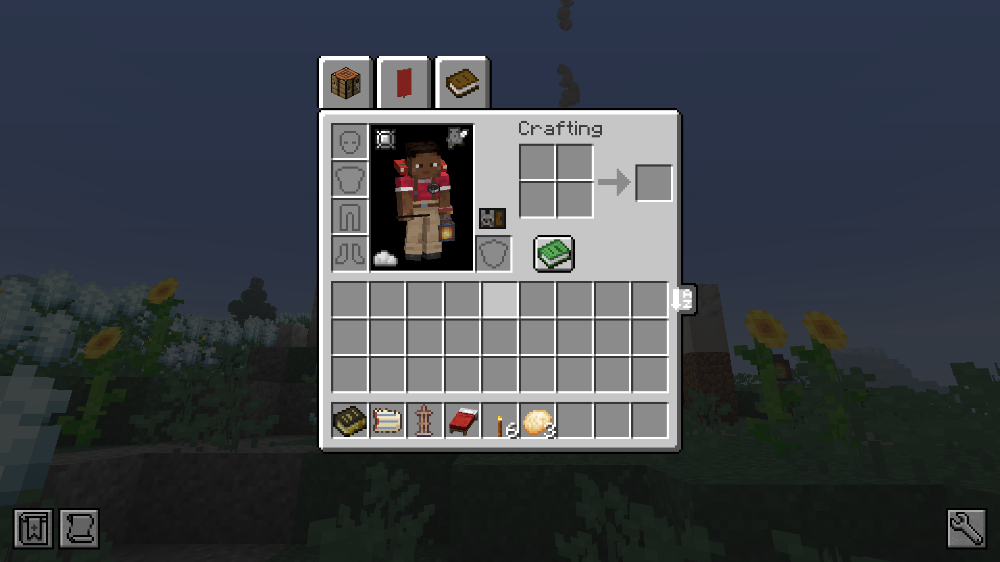
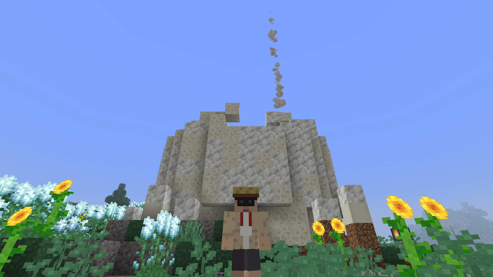

# OreSpawn Integrations 0.10.0: The First Hour

The first part of CrazyCraft 5.0's new story, *The Spilled Hoard*. A new player wakes up on Shelf 9, opens their
Eggshell, and is walked through their first hour one step at a time: the Prince's letter, a gold star falling nearby,
and a clerk who finally puts them on file. This is an alpha: everything here is playable and tested, and the story
goes on in the next versions.

*A new player's Eggshell, opened: the Hoard Field Guide, a Royal Casket, a red bed, 6 torches and 3 cheese breads.*

## What's new
- **Shelf 9, the Hatching Ground.** A new world places it at spawn. New players wake on its straw, and every name goes
  into the Hatch Register on its wall. Its Four Ways signs point to a real village, henge, tower and tavern nearby
  (up to 2,048 blocks out) with the Prince's comment. On a server an operator places it with
  `/cc hatching_ground place`.
- **Your Eggshell.** A new player joins holding one thing. Opening it gives the Hoard Field Guide, a Royal Casket, a red
  bed, 6 torches and 3 cheese breads, and the Egged cap goes to the Wardrobe.
- **The Priority Ticket.** The first hour comes one step at a time, never two within 90 seconds, so nobody is buried in
  books and pop-ups. Each step shows its ticket number.
- **The Prince's Letter.** About five minutes in, the Prince flies over low and drops the Royal Summons at the player's
  feet, indoors too. Its postscript knows which origin you picked.
- **The First Fall.** A few minutes later a gold star whistles down nearby, with coins to punch and a crate addressed
  to you. A newcomer who stays near spawn still gets theirs, and so does one under attack, on the side away from the
  attacker.
- **The Field Odete.** A Registry clerk walks up to the crate, opens your file and hands over the Field Notebook.
- **Region names.** Crossing into a new region shows its name, and the first visit pays a Ledger Scrap.
- **Royal Caskets, Ledger Scraps and Corrections.** The lucky blocks became Royal Caskets with their own tables by
  rank, and scraps buy Corrections at the table.
- **The Registry.** Village Registry desks (the Cartório) and their clerks, the Odetes.
- **Players from before this version** get the late-entry line in the Register, the Summons by air, and a Back-Dated
  Fall with its own notice.

*The Field Odete, the Registry's clerk in the field, outside Shelf 9.*

## Fixes found while testing
- Opening the Eggshell lost the Hoard Field Guide: it landed in the hand slot the shell had just left, and the game
  cleared that slot.
- The First Fall stopped at the landing for every new player, so the crate stayed empty and the Field Odete never came.
- The Summons landed on the roof when the player was indoors or underground.
- The First Fall and the night's Hoard Fall counted structure loot chests, buried campsite furnaces and sky-ship
  furnaces as somebody's home and wouldn't land near them. Only blocks someone could live by count now.
- Shelf 9's Four Ways never search on a live server tick: a new world surveys during start-up, and an operator's
  placement on a running server is surveyed at the next restart.
- A player whose origins an operator set by command never saw region titles.
- Returning players were sometimes taken for newcomers when their stats file was missing.

## Details
- Minecraft 1.21.1, NeoForge 21.1.252. Built for the CrazyCraft 5.0 pack (v2.0.0-alpha.1).
- 91 GameTests run on a test server for every build, and each first-hour step above was checked in the full pack
  on a real client.
- The six OreSpawn dimension biomes keep this mod's sky, fog, colours and sounds and otherwise follow the OreSpawn
  port. Utopia no longer spawns monsters, and the Royal Mines no longer get Ender Knights, Ender Reapers or Mothra.
